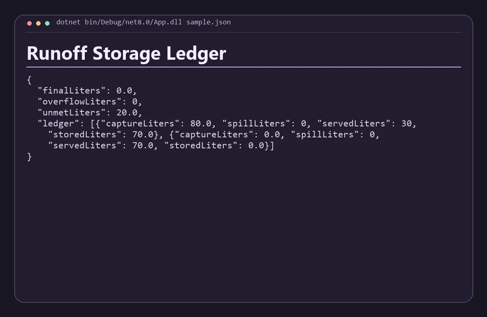

# Runoff Storage Ledger

Replay rainfall capture, tank overflow, and scheduled withdrawals through a water-storage scenario.



## Run

Install .NET 8 SDK and runtime. Run these commands from the repository root.

```sh
dotnet build --nologo
dotnet bin/Debug/net8.0/App.dll sample.json
```

Replace `sample.json` with a JSON file following the same structure. The app prints a JSON report to standard output.

Each day captures rain first, spills volume over capacity, then serves demand. One millimeter over one square meter yields one liter before the capture fraction. This is a water-balance scenario with no evaporation or water-quality model.

## Verify

Run `python check.py` with Python 3.11 or newer after the build step when applicable. The check verifies the bundled scenario and confirms that an invalid input returns an error.
